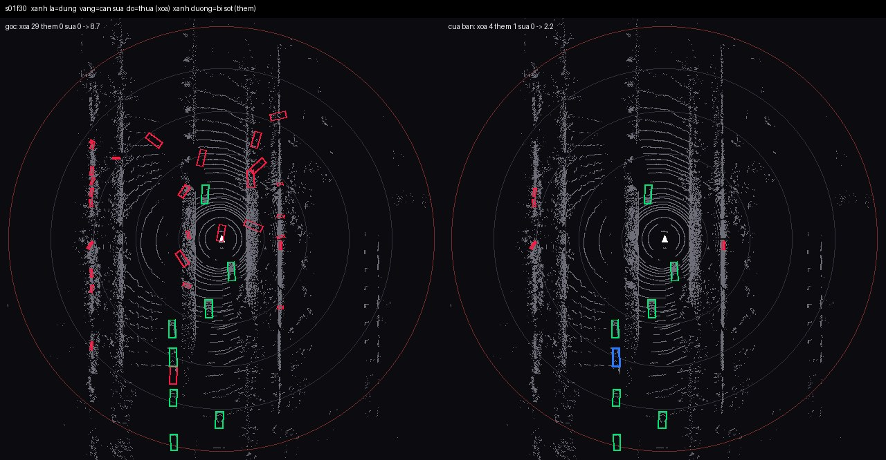

# Báo cáo Day 14 — Pham Huu Minh — 2A202603330

- Mã học viên dùng với `--student`: `330`
- `seed_tag` trong `frames_A.txt`: `82ac3100fd`

Tập A: `s01f30`, `s02f02`, `s04f16`.
Tập B: `s02f16`, `s02f33`, `s02f55`, `s03f02`, `s03f24`, `s03f54`, `s04f05`, `s04f31`, `s04f58`, `s05f01`, `s05f29`, `s05f46`.

## 1. Dự đoán trước sweep (bước 5b)

Ghi **trước** khi chạy `scripts/pp_sweep.py`, rồi commit và push ngay (lịch sử commit là bằng chứng thời điểm viết). Không sửa phần này sau khi có kết quả.

- Tham số tôi nghĩ giảm công sửa nhiều nhất: `score_thr`, nâng từ 0,1 lên khoảng 0,4–0,5.
  `min_points` tôi nghĩ gần như không giúp được gì.

- Vì sao (nhìn ảnh BEV tập A: box thừa nhiều hay box sót nhiều?): Rõ ràng là thừa, không phải sót.
  Model vẽ 86 hộp trên ba frame trong khi tôi chỉ nhận ra 32 vật thật, và số đo ở bước 5 là 55 hộp
  phải xóa nhưng chỉ 1 vật bị bỏ sót. Tiền công nằm gần hết ở việc xóa: 0,3 × 55 là 16,5 trong tổng
  18,0.

  Mở ảnh camera ra xem thì các hộp thừa không rải đều. Chúng bám vào hàng rào cây, thân cây, cột
  đèn và lan can ven đường, tức là vật cố định có cụm điểm to xấp xỉ một chiếc xe con. Những hộp đó
  đều có điểm tin cậy thấp: nhóm tôi giữ lại có score trung vị 0,88, nhóm phải xóa chỉ 0,38. Hai
  nhóm tách nhau khá rõ nên nâng ngưỡng sẽ cắt trúng nhóm sau.

  Tôi không trông chờ vào `min_points` vì hàng rào cây rất dày điểm. Hộp thừa vẫn có trung vị 77
  điểm LiDAR trong hộp, nên lọc theo số điểm chỉ dọn được vài hộp gần như rỗng chứ không đụng tới
  phần lớn hộp bám cây.

  Chỗ phải cân nhắc là công thức phạt lệch nhau: xóa chỉ 0,3 mà thêm tới 1,0. Mỗi vật thật bị
  ngưỡng cắt nhầm phải đổi bằng hơn ba hộp thừa mới hòa vốn. Hộp thật thấp điểm nhất của tôi là
  0,37, nên từ 0,4 trở lên là bắt đầu có rủi ro mất nó, và đó là lý do tôi đoán điểm tốt nhất rơi
  vào quãng 0,4–0,5 chứ không phải càng cao càng tốt.

  Một điểm nữa tôi thấy khi rà nhãn: trong 22 hộp Cyclist model vẽ ra thì chỉ 1 hộp là người đi xe
  thật, 21 hộp còn lại là cây và cột bị nhận nhầm, vì chúng cao và hẹp giống dáng xe đạp. Nếu được
  đặt ngưỡng riêng theo lớp thì `thr_cyc` sẽ là chỗ đáng nâng nhất, nhưng lưới lần này chỉ quét
  `score_thr` chung nên tôi dự đoán theo tham số chung.

  Lưu ý kỹ thuật: hộp thấp điểm nhất trong `pred_A.json` là 0,221, nên `score_thr` 0,1 và 0,2 cho
  ra kết quả y hệt nhau trên ba frame của tôi. Chỉ từ 0,3 trở lên lưới mới thật sự thay đổi gì.

## 2. Tập A: sửa tay và tune

| Cấu hình | Xóa | Thêm | Sửa | Chi phí |
|---|---:|---:|---:|---:|
| Gốc | 55 | 1 | 1 | 18.0 |
| `best_config.json` | 12 | 2 | 1 | 6.1 |

Số của cấu hình gốc đo trên 3 frame tập A: GT 32 hộp, model dự đoán 86 hộp, ghép được 31 cặp.
Theo từng frame: `s01f30` xóa 29, thêm 0, sửa 0 (chi phí 8.7); `s02f02` xóa 20, thêm 1, sửa 0
(chi phí 7.0); `s04f16` xóa 6, thêm 0, sửa 1 (chi phí 2.3).

- Tham số đã đổi trong `best_config.json`: chỉ một tham số, `score_thr` từ `0.1` lên `0.5`.
  `min_points` giữ nguyên `0`. Trong lưới 15 cấu hình, ba cấu hình ở `score_thr=0.5` cho cùng chi
  phí 6,1 dù `min_points` là 0, 5 hay 10, nghĩa là ở ngưỡng này `min_points` không cắt thêm được
  hộp nào nữa.

- Kết quả leave-one-out (dán các dòng `scripts/pp_sweep.py` in ra):

  ```
  s01f30: cấu hình chọn {'score_thr': '0.5', 'min_points': '0'} → 2.2 (tốt nhất có thể 2.2)
  s02f02: cấu hình chọn {'score_thr': '0.5', 'min_points': '0'} → 3.4 (tốt nhất có thể 3.4)
  s04f16: cấu hình chọn {'score_thr': '0.5', 'min_points': '0'} → 0.5 (tốt nhất có thể 0.5)
  ```

- Cấu hình có ổn định trên từng frame không? Vì sao tôi vẫn chọn (hoặc không chọn) nó: Ổn định.
  Bỏ ra frame nào thì hai frame còn lại cũng chọn đúng `score_thr=0.5`, và chấm trên frame bị bỏ
  ra thì chi phí đúng bằng mức tốt nhất có thể. Không có khoảng cách nào giữa cấu hình chọn và
  oracle, tức là không thấy dấu hiệu khớp quá mức vào hai frame dùng để chọn.

  Tôi vẫn giữ thái độ dè dặt. Ba frame là quá ít để kết luận, và sở dĩ leave-one-out đẹp như vậy
  là vì cả ba frame cùng mắc một lỗi giống nhau: hộp thừa bám cây và lan can, điểm tin cậy thấp.
  Khi ba mẫu sai theo cùng một kiểu thì bỏ ra một mẫu chẳng thay đổi gì, nên phép kiểm này dễ dãi
  hơn vẻ ngoài của nó. Nó cho thấy cấu hình không khớp riêng vào một frame, chứ chưa chứng minh
  `0.5` là ngưỡng đúng cho cảnh khác, ví dụ đường vắng mà xe ở xa.

  Tôi cũng không chọn ngưỡng cao hơn nữa. Lưới dừng ở `0.5`, và ngay tại `0.5` số vật bị bỏ sót đã
  tăng từ 1 lên 2, tức là ngưỡng bắt đầu ăn vào vật thật.

## 3. Trước/sau (bước 8)



- `scripts/pp_compare.py` báo giảm 66% công sửa trên tập A, từ 18,0 xuống 6,1. Theo từng frame:
  `s01f30` 8,7 → 2,2; `s02f02` 7,0 → 3,4; `s04f16` 2,3 → 0,5.

- Dự đoán ở mục 1 đúng hay sai? Giải thích bằng số box xóa/thêm/sửa: Phần chính thì đúng, nhưng có
  một ý tôi nói sai.

  Đúng ở chỗ `score_thr` là tham số ăn thua, và quãng tôi đoán là 0,4–0,5 thì máy chọn đúng 0,5.
  Số liệu khớp với cách tôi lập luận: hộp phải xóa rơi từ 55 xuống 12, tức là ngưỡng cắt được 43
  hộp thừa, đổi lại số vật bị bỏ sót tăng từ 1 lên 2. Tính theo công thức là tiết kiệm 0,3 × 43 =
  12,9 và mất thêm 1,0, còn lại 11,9. Đúng bằng khoảng cách 18,0 − 6,1. Số hộp phải sửa vẫn là 1,
  không đổi, nên toàn bộ phần lợi đến từ việc bớt hộp thừa chứ không phải hộp khít hơn.

  Đúng cả ở chỗ `min_points` không giúp được gì. Tại `score_thr=0.5`, ba mức 0, 5 và 10 cho chi phí
  y hệt nhau là 6,1. Lý do như tôi đã viết: hộp thừa bám hàng rào cây vẫn dày điểm, lọc theo số
  điểm không chạm tới chúng.

  Chỗ tôi sai là câu cuối mục 1. Tôi viết rằng hộp thấp điểm nhất trong `pred_A.json` là 0,221 nên
  `score_thr` 0,1 và 0,2 sẽ cho kết quả y hệt nhau. Sweep cho thấy không phải: 0,1 ra 18,0 còn 0,2
  ra 16,8. Kiểm lại thì `s01f30` có một hộp 0,179 và `s02f02` có ba hộp 0,159, 0,174 và 0,187, tức
  là bốn hộp nằm dưới 0,2, đúng bằng 0,3 × 4 = 1,2 chênh lệch giữa hai cấu hình. Con số 0,221 tôi
  lấy nhầm từ một bộ frame khác chứ không đo lại trên ba frame này. Bài học là số đo phải gắn với
  đúng bộ dữ liệu đang nói tới, nhất là khi bộ frame đã đổi giữa chừng.

  Sai sót đó không làm đổi kết luận, vì nó chỉ nói về hai mức thấp nhất của lưới, còn cấu hình được
  chọn nằm ở đầu kia. Nhưng nó cho thấy tôi đã tin một con số cũ thay vì đo lại.

## 4. Tập B

Số đo từ `scripts/pp_prelabel.py --frames d14_330/frames_B.txt --config d14_330/best_config.json --gt d14_330/ref_B.json`:

| Xóa | Thêm | Sửa | Chi phí |
|---:|---:|---:|---:|
| 57 | 11 | 4 | 30.1 |

Trên 12 frame: nhãn tham chiếu 110 hộp, model dự đoán 156 hộp, ghép được 99 cặp. Chi phí tách ra là
0,3 × 57 = 17,1 cho phần xóa, 1,0 × 11 = 11,0 cho phần thêm và 0,5 × 4 = 2,0 cho phần sửa.

Nhãn cuối cùng gồm Car 95, Cyclist 7, Truck 4, Bus 2, Pedestrian 2.

- Loại box tốn công sửa nhất ở tập B: **Cyclist**, nếu tính theo tỷ lệ sai. Model vẽ 26 hộp Cyclist
  thì tôi phải xóa 21, chỉ giữ 5. Tức là hơn 80% hộp Cyclist là sai, trong khi Car chỉ sai 37 trên
  129 hộp, khoảng 29%. Lý do nhìn trên ảnh rất rõ: thân cây, cột đèn và cọc rào đều cao và hẹp, đúng
  dáng một người đi xe đạp nhìn từ đám mây điểm.

  Nhưng nếu tính theo chi phí thật thì nhóm tốn nhất lại là xe lớn. 11 hộp phải thêm chiếm 11,0
  trong tổng 30,1, tức hơn một phần ba công sửa, mà chỉ từ 11 hộp. Trong đó có 4 Truck và 2 Bus,
  toàn bộ là lớp model không thể sinh ra vì KITTI không có. Một chiếc xe buýt bị bỏ sót tốn 1,0,
  bằng hơn ba hộp thừa phải xóa.

  Nói cách khác, hai nhóm tốn công vì hai lý do ngược nhau: Cyclist tốn vì model vẽ quá nhiều hộp
  sai, còn Truck và Bus tốn vì model không vẽ được hộp nào cả.

## 5. Giới hạn

- Chỉ có 3 frame để tune, mà ba frame lại khác nhau quá nhiều. `s01f30` là đại lộ hai bên dày đặc
  hàng rào cây, `s02f02` có xe buýt chạy sát bên trái, `s04f16` là đường nhiều làn thoáng. Cấu
  hình hợp với frame này rất dễ hỏng ở frame kia. Phải đọc leave-one-out rồi mới tin số "tốt nhất".
- Model học trên KITTI, chỉ biết Car, Cyclist và Pedestrian. Truck với Bus thì nó không sinh ra
  được: chiếc buýt ở `s02f02` bị cắt thành tám hộp Car rời nhau, còn hộp Bus trong nhãn tham chiếu
  là người tự thêm.
- Hộp thừa gần như đều nằm trên hàng rào cây, thân cây, cột và lan can. Cụm điểm của chúng to xấp
  xỉ một chiếc xe con, nên nhìn số đo rất khó loại; phải mở ảnh camera mới biết.
- Chi phí sửa chỉ là công thức `0.3·xóa + 1.0·thêm + 0.5·sửa`, không phải thời gian thật, và chỉ
  tính hộp có tâm trong 50 m.
- `ref_A.json` là đáp án do chính tôi dựng, rồi sweep lại dò tham số theo đúng đáp án đó. Tôi nhận
  nhầm chỗ nào thì cấu hình được chọn sẽ hợp với cái nhầm đó, và tập B thừa hưởng luôn.
- Nhãn tập B dựng từ `pred_B.json`, mà file này chạy bằng `score_thr=0.5`. Ngưỡng đó chọn để giảm
  công sửa, nhưng nó cắt mất hai phần ba số hộp model sinh ra, nên xe thật nào model chấm dưới 0,5
  thì ngay từ đầu đã không có trong task. Tôi phải chạy lại ở `0.1` (358 hộp so với 156) rồi rà
  tay mới bù lại được. Bài học: nhãn tham chiếu phải chứa mọi vật thật, bất kể model chấm bao
  nhiêu; đừng để tham số đã tune quyết định cái gì tồn tại.
- Còn sót có chủ ý ở nhóm xe bên kia dải phân cách, cách 25–50 m, nhìn qua khe hàng rào. Ví dụ rõ
  nhất là `s04f05`: ảnh `cam03` thấy rõ một xe buýt xanh, một xe tải xanh lá và một xe cứu thương,
  nhưng cả vùng đó chỉ có 128 điểm LiDAR trải từ 25 đến 60 m, phần lớn đã ra ngoài 50 m. Mục 6 của
  guideline cho phép bỏ qua vật quá thưa điểm nếu ghi lại, nên tôi ghi ở đây thay vì vẽ hộp mà
  kích thước gần như là bịa.
